# Pandora's Launcher — Pandora's Tower (Dionixu's Launcher)

> A way to play *Pandora's Tower* (Wii) on PC, with the care it deserves.

[](https://ko-fi.com/dionixu838824)

Launcher e instaladores para Windows y Linux que convierten **tu copia original** de *Pandora's Tower* (Wii) en una experiencia de PC: texturas HD, voces japonesas con textos en español, inglés o francés, iconos de mando Xbox o de teclado, controles configurables, menú de pausa y avisos de logros.

**Español** · [English](#english) · [Français](#français)

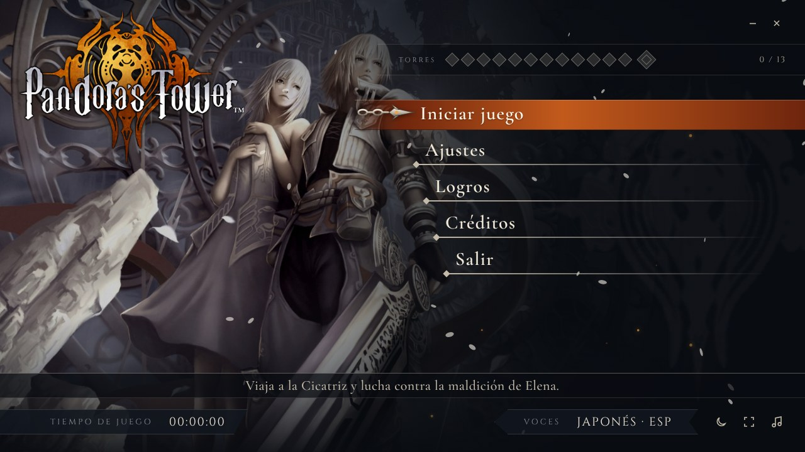

---

## ⚠️ Aviso legal

- Este proyecto **NO incluye el juego**.
- Necesitas **dos copias originales** de *Pandora's Tower* para Wii, extraídas por ti de tus propios discos:
  - versión americana (NTSC-U, `SX3EXJ`): el juego y los textos;
  - versión japonesa *Pandora no Tō* (NTSC-J, `SX3J01`): las voces japonesas.
- El instalador comprueba ambas copias (ID y huellas MD5) y **solo funcionará con tu copia oficial**. Rechaza las copias modificadas, incompletas o de otra región.
- Las voces japonesas se reconstruyen **en tu equipo a partir de tus discos**: el instalador no trae audio del juego, solo una receta con referencias.
- **No se acepta ni se fomenta la piratería.** Necesitas tu copia oficial.
- Es un proyecto de aficionados sin fines de lucro, sin relación con Nintendo, Ganbarion ni XSEED Games.

## Funciones

- Launcher con el estilo del juego (inspirado en el menú de *Dissidia 012*), en español, inglés y francés, con tema Noche y Alba.
- Música del menú y sonidos sacados del propio juego.
- Voces japonesas (también en cinemáticas y lip-sync) con textos en español, inglés o francés.
- Texturas HD e iconos de botones de **mando Xbox Series X** (con la posición de Nintendo) o de **teclado QWERTY y ratón**, que cambian solos según lo que uses.
- Controles editables como en un juego de PC: mando y teclado/ratón a la vez, cámara con ratón, y los iconos del juego se redibujan con tus teclas.
- Menú de pausa con **L3 + R3** o **F1**: volumen del juego en vivo y volver al launcher.
- Avisos de logros dentro del juego, ventana sin bordes, cursor propio y **sin la pantalla de la correa del Wiimote**.
- Totalmente manejable con mando (A acepta, B vuelve), y el ratón se esconde al usar el mando.

## Capturas

| Launcher | |
|---|---|
|  | 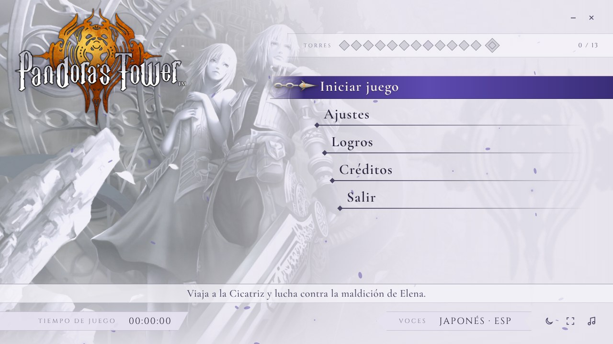 |
| 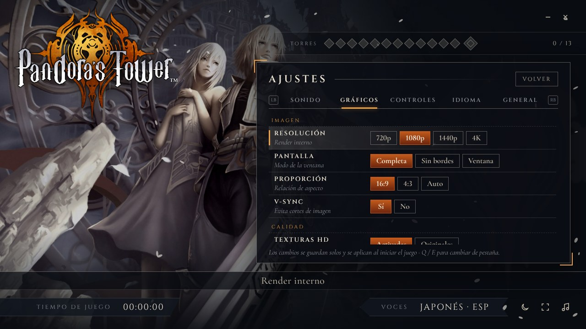 | 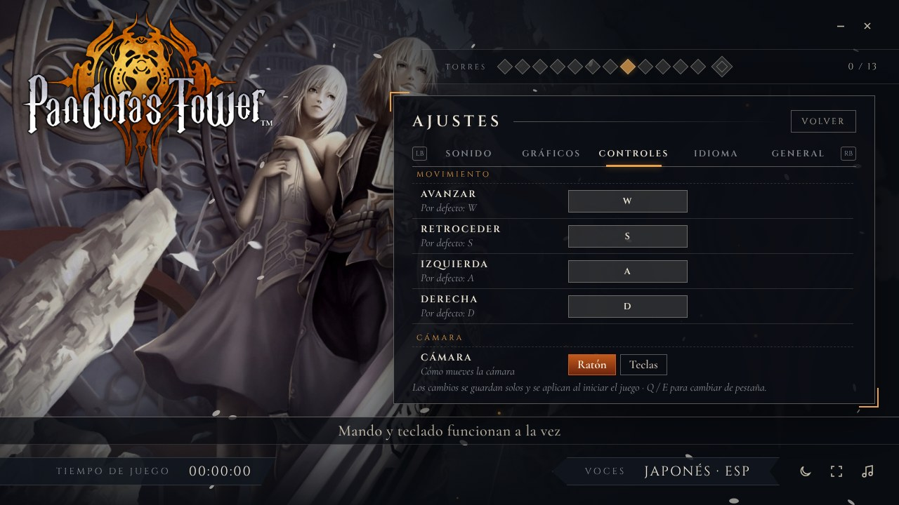 |
| 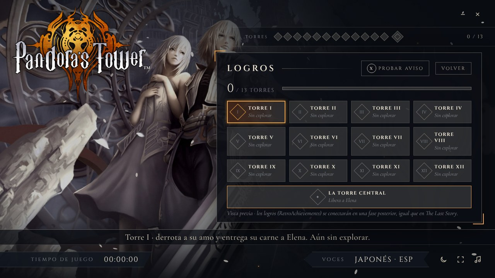 | 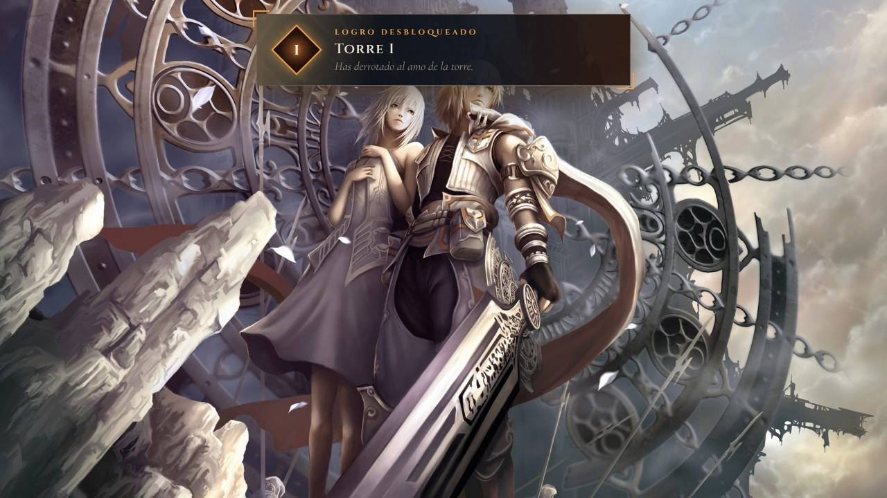 |
| 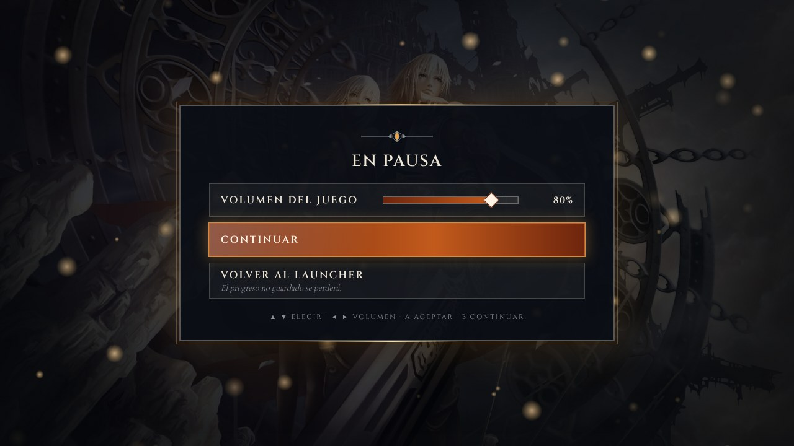 | |

| Instalador | |
|---|---|
| 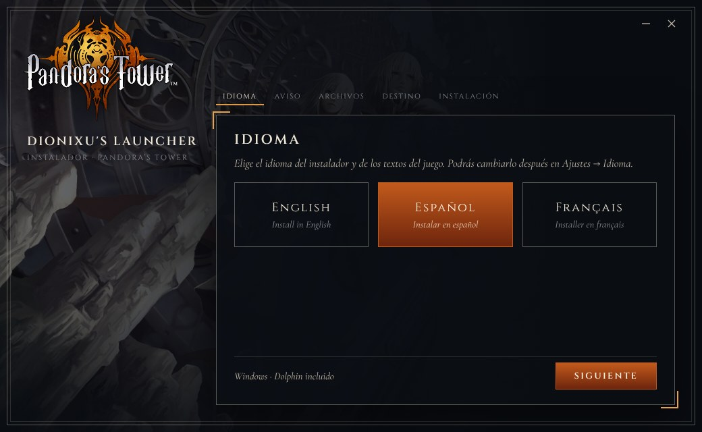 | 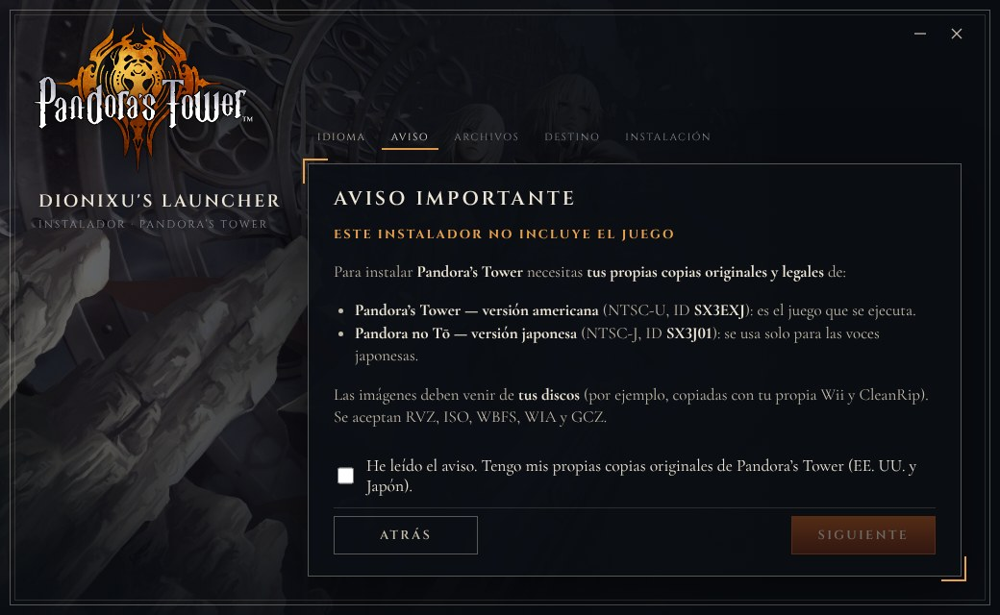 |
| 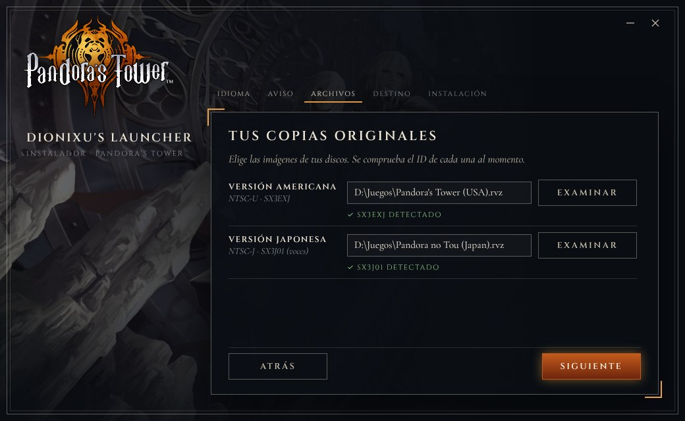 | 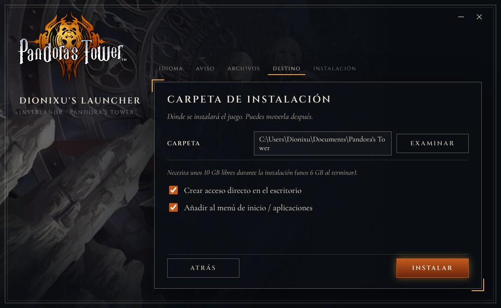 |
| 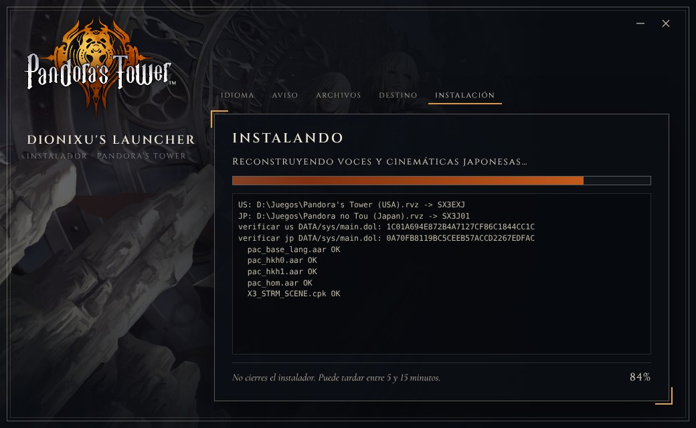 | 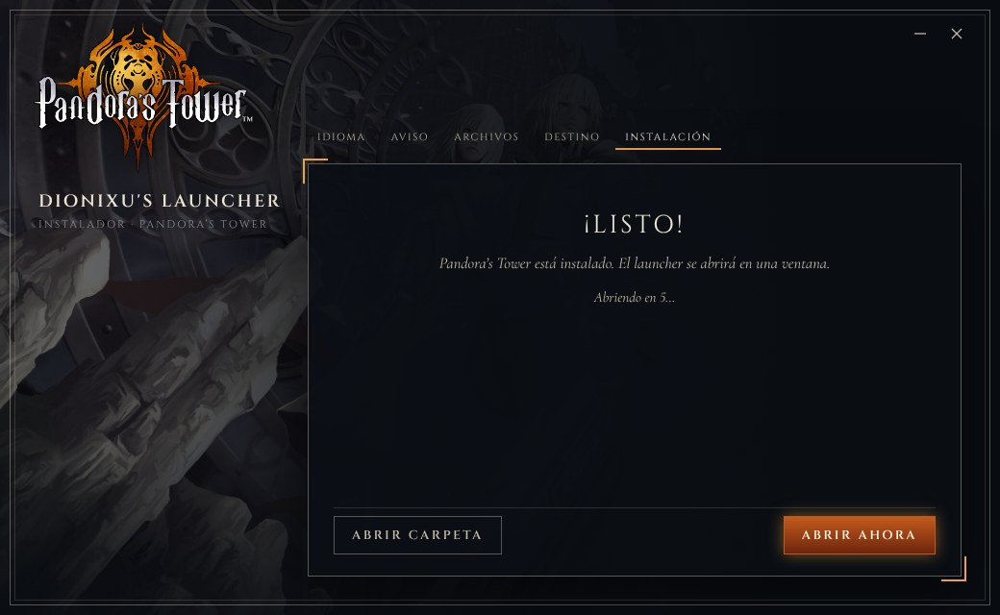 |

## Descargas

Los instaladores están en **[Releases](../../releases)**:
- **Windows 10/11:** carpeta `Windows` (abre `Instalar Pandora's Tower.exe`). Dolphin viene incluido.
- **Linux:** `Instalar_Pandoras_Tower-x86_64.AppImage` (Debian 12, Ubuntu 22.04, Mint 21, Fedora 36 o más nuevos). Usa tu propio Dolphin.

## Instalación

### Windows (10 u 11, 64 bits)
1. Ten unos **10 GB libres** (unos 6 GB al terminar) y tus dos copias del juego (`.rvz`, `.iso`, `.wbfs`, `.wia` o `.gcz`).
2. Descarga y descomprime la carpeta `Windows` completa (no ejecutes el instalador desde dentro del `.zip`/`.rar`).
3. Abre **`Instalar Pandora's Tower.exe`**. Si SmartScreen avisa: *Más información → Ejecutar de todas formas*.
4. Elige el idioma, acepta el aviso legal y elige tus copias americana (`SX3EXJ`) y japonesa (`SX3J01`).
5. Elige la carpeta (por defecto `Documentos\Pandora's Tower`) y pulsa **INSTALAR**. Tarda de 5 a 15 minutos y el launcher se abre solo.

### Linux (AppImage)
1. Ten unos **10 GB libres** y tus dos copias del juego.
2. Instala **tu propio Dolphin** (recomendado el Flatpak, versión actual):
   ```bash
   sudo apt install flatpak
   flatpak remote-add --if-not-exists flathub https://dl.flathub.org/repo/flathub.flatpakrepo
   flatpak install flathub org.DolphinEmu.dolphin-emu
   ```
3. Da permiso de ejecución y abre el AppImage:
   ```bash
   chmod +x Instalar_Pandoras_Tower-x86_64.AppImage
   ./Instalar_Pandoras_Tower-x86_64.AppImage
   ```
   Si no abre, instala FUSE (`sudo apt install libfuse2`) o usa `--appimage-extract-and-run`.
4. Elige el idioma, tu Dolphin (se detecta solo), tus dos copias y la carpeta (por defecto `~/Games/Pandora's Tower`).
5. Opcional: `sudo apt install pulseaudio-utils` para el volumen en vivo del menú de pausa.
6. ¿Mando genérico (DirectInput, p. ej. Shanwan) con los botones cruzados en el juego? Pon **Ajustes → Controles → Controles automáticos = No** y configura el mando una vez en Dolphin; el launcher respetará esa configuración.

Más detalles en [`instalador/docs/INSTRUCCIONES_Windows.txt`](instalador/docs/INSTRUCCIONES_Windows.txt) y [`instalador/docs/INSTRUCCIONES_Linux.txt`](instalador/docs/INSTRUCCIONES_Linux.txt).

### Crear los instaladores (desarrolladores)
En Windows, con el proyecto completo (juego extraído, Dolphin y texturas HD en su sitio), ejecuta `scripts\07_CREAR_INSTALADORES.bat`. Crea `INSTALADORES\Windows` y `INSTALADORES\Linux`; el AppImage se arma en el propio Windows (`instalador/build/appimage.js`, sin herramientas de Linux).

## Agregar a Steam (opcional, Windows y Linux)
En la carpeta [`steam/`](steam/) está **`AGREGAR_A_STEAM.bat`**: copia `AGREGAR_A_STEAM.bat`, `AGREGAR_A_STEAM.ps1` y la carpeta `arte` dentro de la carpeta del juego y haz doble clic. Agrega el juego a Steam como *juego que no es de Steam* con portada, fondo, logo e icono, para **cualquier usuario de Steam** del PC (si no encuentra el juego, te deja elegir el `.exe`). Si ya estaba agregado solo lo actualiza, sin perder tu tiempo de juego. Si el mando no responde: *clic derecho al juego → Propiedades → Mando → Desactivar Steam Input*.

**Linux / Steam Deck:** el `.bat` es solo de Windows. En Linux usa **`agregar_a_steam.sh`** (misma carpeta [`steam/`](steam/), necesita Python 3, que ya viene en casi todas las distribuciones y en Steam Deck): el instalador lo deja en la carpeta del juego; si no, copia `agregar_a_steam.sh`, `agregar_a_steam.py` y `arte` ahí. Luego, en una terminal dentro de la carpeta del juego: `./agregar_a_steam.sh`. Hace lo mismo que el `.bat` (portada, fondo, logo, icono, todos los usuarios; funciona con Steam nativo, Flatpak y Steam Deck en modo escritorio).

## Estructura

| Carpeta | Contenido |
|---|---|
| `launcher/resources/app/` | Proceso principal (`main.js`, Windows y Linux) y puente de mando para Windows (`bridge.ps1`) |
| `launcher/ui/` | Interfaz del launcher, menú de pausa, aviso de logros, música, sonidos, glifos y cursor |
| `launcher/data/botones/` | Iconos del juego para mando Xbox y teclado/ratón |
| `instalador/app/` | Instalador (Electron) y reconstrucción de las voces japonesas (`voces.js` + `receta_voces.json`) |
| `instalador/build/` | Creador del AppImage (squashfs + runtime de AppImage) en JavaScript |
| `instalador/appimage/`, `instalador/docs/` | Archivos del AppImage e instrucciones |
| `linux/` | `pt_bridge`: mando, F1, foco y ventana sin bordes en Linux |
| `herramientas/` | Formatos de Ganbarion (ALAR/ALLZ), CRI (CPK/CSB), texturas, glifos y código fuente de `pt_bridge` |
| `scripts/` | Pasos reproducibles: extraer, voces japonesas, botones, launcher, carpeta final e instaladores |
| `capturas/` | Capturas del launcher y del instalador |

## ☕ Apoya el proyecto

Si te gustó y quieres apoyarme, puedes invitarme un café en Ko-fi: **https://ko-fi.com/dionixu838824**

## Créditos

- **Proyecto:** Dionixu's Launcher, por Dionixu ([@kaiwolft](https://github.com/kaiwolft)).
- **Desarrollado junto a Claude** (Anthropic), que escribió el código con Dionixu: launcher, instaladores, parche de voces japonesas, iconos de botones, puente de Linux y creador del AppImage.
- **Correcciones de Linux heredadas de [TLSHD Launcher](https://github.com/kaiwolft/TLSHDLAUNCHER):** daetrox ([@daetrox](https://github.com/daetrox)) — Wayland/X11, mandos genéricos (DirectInput), detección de teclado y foco de Dolphin.
- **Creado para este proyecto (Dionixu y Claude):**
  - iconos de botones de mando Xbox Series X y de teclado QWERTY/ratón para el juego, y glifos del launcher;
  - cursor con la Cadena de Oraclos, icono del launcher y diseño de la interfaz y del instalador;
  - parche de voces japonesas (receta que se aplica sobre tus discos), parche para quitar la pantalla de la correa del Wiimote y herramientas de los formatos del juego.
- **Texturas HD:** paquete HD de *Pandora's Tower* (`SX3EXJ`) de la comunidad de Dolphin y sus autores — [hilo en los foros de Dolphin](https://forums.dolphin-emu.org/Thread-pandora-s-tower-hd-texture-2017-02-24). El emblema del launcher sale de este paquete.
- **Música del launcher:** «Catenae Fortunae (Dies Irae)», tema principal de *Pandora's Tower* (banda sonora original del juego).
- **Sonidos del menú:** efectos de sonido de *Pandora's Tower*.
- **Dolphin Emulator** (GPLv2): [dolphin-emu.org](https://dolphin-emu.org).
- **Electron** (MIT): [electronjs.org](https://www.electronjs.org) · **AppImage runtime** (MIT): [appimage.org](https://appimage.org).
- **Fuentes:** Cinzel, Cormorant Garamond e Inter (SIL OFL).
- **Inspiración de diseño:** *The Last Story* (TLSHD Launcher) y el menú de *Dissidia 012 Final Fantasy*.
- *Pandora's Tower* © Nintendo / Ganbarion.

> **Derechos:**
> - Es un homenaje de fans sin fines de lucro.
> - La música, los sonidos, el arte, los logotipos y las marcas pertenecen a sus respectivos dueños. Se usan sin intención de infringir.
> - Si eres titular de algún contenido y quieres que se retire, abre un *issue* en este repositorio o escribe por Ko-fi y se quitará de inmediato.

---

## English

Launcher and Windows/Linux installers that turn **your original copy** of *Pandora's Tower* (Wii) into a PC experience:

- HD textures;
- Japanese voices with English, Spanish or French text;
- Xbox Series X or keyboard/mouse button prompts that switch automatically;
- remappable controls (gamepad and keyboard/mouse at the same time);
- a pause menu (L3 + R3 or F1) with live volume;
- in-game achievement alerts, no Wii Remote strap screen, launcher in English, Spanish and French.

**Legal notice:**

- The game is **not included**.
- You need your own **original North American (`SX3EXJ`) and Japanese (`SX3J01`)** copies.
- The installer verifies both and will **only work with your official copy**. Japanese voices are rebuilt on your computer from your own discs.
- **Piracy is not accepted or encouraged.**

**Install:**
- **Windows 10/11:** unpack the `Windows` folder from Releases and open `Instalar Pandora's Tower.exe` (Dolphin included). About 10 GB free needed.
- **Linux:** install Dolphin (Flatpak recommended), then `chmod +x Instalar_Pandoras_Tower-x86_64.AppImage` and run it. Generic DirectInput pads: set *Settings → Controls → Automatic controls = No* and configure the pad once in Dolphin.

Full steps in `instalador/docs/INSTRUCCIONES_*.txt`. To build the installers, run `scripts\07_CREAR_INSTALADORES.bat` on Windows.

☕ **Buy me a coffee:** https://ko-fi.com/dionixu838824

**Credits:** Dionixu's Launcher by Dionixu ([@kaiwolft](https://github.com/kaiwolft)). **Built together with Claude (Anthropic).** Linux fixes inherited from TLSHD Launcher by daetrox ([@daetrox](https://github.com/daetrox)). Created for this project by Dionixu and Claude: Xbox Series X and keyboard/mouse button prompts, launcher glyphs, Oraclos Chain cursor, launcher and installer design, the Japanese-voice recipe and the strap-screen patch. HD textures: *Pandora's Tower* HD pack (`SX3EXJ`) by the Dolphin community and its authors. Launcher music: “Catenae Fortunae (Dies Irae)”, *Pandora's Tower* main theme from the original soundtrack. Menu sounds from *Pandora's Tower*. Also Dolphin, Electron, AppImage, and the Cinzel, Cormorant Garamond and Inter fonts. *Pandora's Tower* © Nintendo / Ganbarion. Non-profit fan tribute: all music, sounds, artwork and trademarks belong to their owners, and rights holders can request removal through an issue.

### Add to Steam (optional, Windows and Linux)
The [`steam/`](steam/) folder contains **`AGREGAR_A_STEAM.bat`**: copy `AGREGAR_A_STEAM.bat`, `AGREGAR_A_STEAM.ps1` and the `arte` folder into the game folder and double-click it. It adds the game to Steam as a *non-Steam game* with cover, background, logo and icon, for **any Steam account** on the PC (if it cannot find the game it lets you pick the `.exe`). If it was already added it is only updated, keeping your play time. If the controller does not respond: *right-click the game → Properties → Controller → Disable Steam Input*.

**Linux / Steam Deck:** the `.bat` is Windows-only. On Linux use **`agregar_a_steam.sh`** (same [`steam/`](steam/) folder, needs Python 3, already present on most distros and on Steam Deck): the installer puts it in the game folder; otherwise copy `agregar_a_steam.sh`, `agregar_a_steam.py` and `arte` there. Then, in a terminal inside the game folder: `./agregar_a_steam.sh`. Same result as the `.bat` (cover, background, logo, icon, all accounts; native Steam, Flatpak Steam and Steam Deck desktop mode).

## Français

Launcher et installateurs Windows/Linux qui transforment **ta copie originale** de *Pandora's Tower* (Wii) en expérience PC :

- textures HD ;
- voix japonaises avec textes en français, anglais ou espagnol ;
- icônes de manette Xbox Series X ou clavier/souris qui changent toutes seules ;
- commandes configurables ;
- menu pause (L3 + R3 ou F1) avec volume en direct ;
- alertes de succès en jeu, sans l'écran de la dragonne de la Wiimote, launcher en français, anglais et espagnol.

**Avertissement :**

- Le jeu **n'est pas inclus**.
- Il te faut tes **copies originales américaine (`SX3EXJ`) et japonaise (`SX3J01`)**.
- L'installateur les vérifie et **fonctionne uniquement avec ta copie officielle**. Les voix japonaises sont reconstruites sur ton ordinateur à partir de tes disques.
- **Le piratage n'est ni accepté ni encouragé.**

**Installation :** Windows : ouvre `Instalar Pandora's Tower.exe` (Dolphin inclus). Linux : installe Dolphin (Flatpak conseillé), puis `chmod +x Instalar_Pandoras_Tower-x86_64.AppImage` et lance-le. Détails dans `instalador/docs/INSTRUCCIONES_*.txt`.

☕ **Offre-moi un café :** https://ko-fi.com/dionixu838824

**Crédits :** Dionixu's Launcher par Dionixu ([@kaiwolft](https://github.com/kaiwolft)). **Développé avec Claude (Anthropic).** Corrections Linux héritées de TLSHD Launcher par daetrox ([@daetrox](https://github.com/daetrox)). Créés pour ce projet par Dionixu et Claude : icônes Xbox Series X et clavier/souris, glyphes, curseur, design du launcher et de l'installateur, recette des voix japonaises et patch de l'écran de la dragonne. Textures HD : pack HD de *Pandora's Tower* (`SX3EXJ`) de la communauté Dolphin et ses auteurs. Musique du launcher : « Catenae Fortunae (Dies Irae) », thème principal de *Pandora's Tower*. Sons du menu de *Pandora's Tower*. Aussi Dolphin, Electron, AppImage et les polices Cinzel, Cormorant Garamond et Inter. *Pandora's Tower* © Nintendo / Ganbarion. Hommage de fans à but non lucratif : la musique, les sons, les illustrations et les marques appartiennent à leurs propriétaires.

### Ajouter à Steam (optionnel, Windows et Linux)
Le dossier [`steam/`](steam/) contient **`AGREGAR_A_STEAM.bat`** : copiez `AGREGAR_A_STEAM.bat`, `AGREGAR_A_STEAM.ps1` et le dossier `arte` dans le dossier du jeu, puis double-cliquez. Le jeu est ajouté à Steam (*jeu non-Steam*) avec jaquette, fond, logo et icône, pour **n'importe quel compte Steam** du PC. Si la manette ne répond pas : *clic droit sur le jeu → Propriétés → Manette → Désactiver Steam Input*.

**Linux / Steam Deck :** le `.bat` est réservé à Windows. Sous Linux, utilisez **`agregar_a_steam.sh`** (même dossier [`steam/`](steam/), nécessite Python 3) : copiez `agregar_a_steam.sh`, `agregar_a_steam.py` et `arte` dans le dossier du jeu si l'installateur ne l'a pas fait, puis lancez `./agregar_a_steam.sh` dans un terminal depuis ce dossier.
